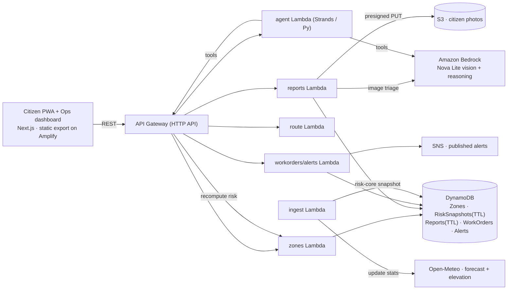
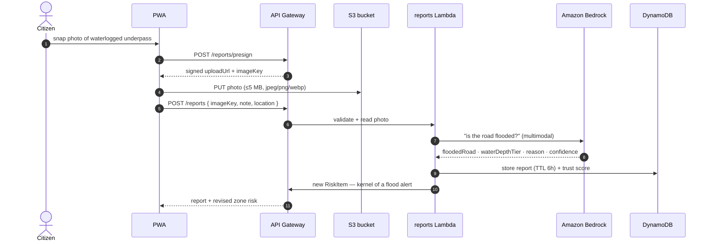

# Aquashield

Aquashield is a hyperlocal urban flood early-warning and safe-routing system for Delhi,
focused on **underpass waterlogging**. Instead of a city-wide amber alert an hour late, it
tracks each underpass — **15 real locations** seeded with surveyed geometry — and runs the
loop **Detect → Verify → Predict → Explain → Act**:

- A **citizen PWA** shows a street-level risk map, lets anyone file a **3-tap photo report**,
  gets a safe reroute around flooded underpasses, and bilingual alerts.
- A **city-ops dashboard** (/ops) ranks hotspots, gets AI-generated action plans and alert
  drafts (English + Hindi), and converts them into work orders.

The risk number is an **explainable weighted index 0–100** (not a probability) that always
arrives with its factor breakdown, and reports / resolutions flow through a real backend —
no local-storage tricks. Built for the **WeMakeDevs x AWS Environmental Hacks** hackathon
(Track: Heat and Water, Oct 8–11 2026).

- **Live app** (Amplify Hosting): https://p2-ui-overhaul.d1pcm8ed2lwjto.amplifyapp.com
- **Live API**: https://i0ew0j1bdk.execute-api.ap-southeast-2.amazonaws.com/prod
- **Demo video**: https://youtube.com/playlist?list=PLfQqXjqQA0_A&si=ayB4XdOpde9iG7YT

---

## How it's put together

A few decisions the whole system leans on:

**Risk is a weighted index, not a guess.** Every zone carries surveyed statics
(depression depth, drainage deficit, history score, critical rain threshold). The risk engine
— a single module in `packages/risk-core` — combines baseline risk with **live rain** from
Open-Meteo and **verified citizen reports**, pushing the score toward CRITICAL when a flood
photo is corroborated. The engine is one function; the same code runs on the backend, in the
rainfall simulator, and in tests. There is no second, hand-tuned implementation anywhere.

**Reports are verified by a vision model, and trust is a real score.** A photo upload goes to
S3 via a presigned URL, and Amazon Bedrock (Nova Lite, multimodal) decides
`floodedRoad` / `waterDepthTier` / `reason`. A trust score folds in model confidence,
corroboration against nearby reports and current rain, and time decay. A clear-road photo is
`unverified` and **does not** inflate risk — verified live, not hand-waved.

**The AI agent never invents numbers.** `/agent/ask` runs a Strands Agents SDK agent
(Python Lambda) that answers only from tool calls: `get_zone_risk`, `get_forecast`,
`get_nearby_reports`, `get_nearby_zones`, `plan_safe_route`, `create_work_order`,
`draft_alert`, `publish_alert`. Outputs must validate against the `AgentPlan` Pydantic schema
(mirror of the zod contract). Creating work orders or publishing alerts requires
`execute=true` — which the UI only sets after a human click.

**The contract is the source of truth.** `packages/types` (zod) defines every endpoint. The
backend validates every request and response against it, the frontend parses responses with
it (so drift fails loudly), and mocks are checked by `npm test`. Changing an endpoint shape
means changing types + mocks + `docs/CONTRACT.md` in one PR.

**Everything degrades honestly.** Open-Meteo unreachable → cached forecast with a `stale`
badge. Bedrock down → the report is saved as `needs_review` at half trust instead of a fake
verdict. Routing provider down → OSRM fallback, then a clearly-labelled precomputed demo
route. Nothing silently pretends it worked.

## Diagrams

The overall shape:



What one citizen flood report looks like:



## Tech stack

| Piece | What | Notes |
|-------|------|-------|
| Frontend | Next.js 15, React 19, Tailwind, MapLibre GL JS | citizen PWA + ops dashboard, EN/HI |
| Backend | API Gateway HTTP API + Lambda (Node 20 TS) | 6 lambdas, scale-to-zero |
| Data | DynamoDB on-demand + TTL | zones, 48 h risk snapshots, 6 h reports |
| Storage | S3 | citizen photos via presigned upload, private |
| Forecast | Open-Meteo | 15-min EventBridge Scheduler ingest |
| AI vision | Amazon Bedrock (Nova Lite, ap-southeast-2) | flooded-road triage + reasoning |
| Agent | Strands Agents SDK (Python Lambda) | grounded plans, validated AgentPlan |
| Alerting | SNS | published-alert fan-out |
| Routing | OSRM via backend | never called from the browser |
| Hosting | AWS Amplify Hosting | static export (`apps/web/out`) |
| IaC | AWS SAM (`infra/template.yaml`) | CloudWatch logs + dashboards |
| Contract | `packages/types` (zod) · `packages/risk-core` | shared, single source of truth |

## What's tested

```bash
npm test          # validate:mocks + risk-core tests    → 9/9
npm run typecheck # all workspaces + scripts + lambdas  → 0 errors
npm run build     # Next production build               → clean
npm run verify:backend  # hits the LIVE deployed API    → 8/8
```

On top of that there's a live harness against the deployed stack (`mocks=OFF`), kept green:
`GET /zones` serves all **15 real zones** (seeded from surveyed GeoJSON, not placeholders),
report creation round-trips through S3 → Bedrock → DynamoDB, agent planning returns a
schema-valid plan, and ops work-orders + alerts are created/published via the live API.

The **vision triage** module is evaluated honestly on a labelled set of **32 images**
(`data/eval/`), running the *same shipped module* via a CLI bridge. Real Bedrock run
(Amazon Nova Lite `amazon.nova-lite-v1:0`):

| Metric | Value |
|--------|-------|
| Accuracy | **0.793** |
| Precision / Recall / F1 | **0.812** |
| Inferences | 29/32 real (3 fell back to `needs_review`, excluded — never counted correct) |

## Things that bit us while building this

These are all fixed, but each one taught us something:

**1. "Resolved" reports vanished entirely.** Ops could mark a report resolved (client-side,
localStorage), but the backend never knew — so the KPI and live map kept counting it. We
added `PATCH /reports/{zoneId}/{id}` (passcode-gated), persisted `status:"resolved"` in
DynamoDB, and the past/resolved tab now reads `GET /reports?status=resolved` instead of
relying on whatever the active list still contained. Verified live: resolve → active list
drops 7→6, past tab shows it.

**2. Clear-road photos inflated flood risk.** Before, a photo showing a dry road still fed
its trust into the zone's live evidence. `statusFrom()` now returns `unverified` when the
model sees no standing water, and risk only counts verified/unverified flooding evidence.
Verified live with a real clear-road image: `floodedRoad:false, depth:none`, risk unchanged.

**3. A hardcoded Windows path broke the deploy.** `outputFileTracingRoot` in
`apps/web/next.config.mjs` was pinned to `C:/Users/BIT/...` to fix a dual-lockfile confusion —
which breaks on Amplify's Linux build. It's now derived from the config file's own location.

**4. SSR hosting wanted a manifest we never produced.** Amplify in WEB_COMPUTE mode requires a
Next.js `deploy-manifest.json`, which auto-detect never generates for a monorepo app
(`Framework: None` → `cd apps/web` build → deploy 404). We switched to a clean **static
export** (`output: "export"`, `apps/web/out`) with an SPA fallback rule so every route works
and the env vars are baked in at build time.

## Project layout

An npm-workspaces monorepo (one shared lockfile):

| Directory / file | Role |
|------------------|------|
| `apps/web/` | Citizen PWA + ops dashboard (Next.js, static export) |
| `packages/types/` | API contract (zod) — single source of truth |
| `packages/risk-core/` | risk engine (explainable 0–100 index) + tests |
| `services/api/` | API Gateway lambdas: zones, reports, route, ops, agent, vision |
| `services/ingest/` | 15-min Open-Meteo → risk-snapshot ingest lambda |
| `services/agent/` | Strands agent (Python) + schema + tests |
| `data/` | zones GeoJSON, Open-Meteo archive, eval set (`data/eval/`), sources |
| `mocks/` | contract-validated mock responses |
| `infra/template.yaml` | SAM template (IaC) |
| `scripts/` | build lambdas, validate mocks, mock API server, live-api verifier |
| `docs/` | CONTRACT, RISK_ENGINE, DEMO script, PLAYBOOK, ONBOARDING, SUBMISSION |

```text
Aquashield/
├── apps/web/                 # Next.js PWA + ops (output: "export")
│   ├── app/                  # / (landing) · /map (citizen) · /ops (city)
│   ├── components/           # map, ops, report flow, landing
│   └── lib/                  # api client, store, i18n (EN/HI)
├── packages/
│   ├── types/                # zod contract, shared by all
│   └── risk-core/            # risk engine + tests
├── services/
│   ├── api/src/              # zones · reports · route · ops · agent · vision
│   ├── ingest/src/           # Open-Meteo → risk snapshots
│   └── agent/                # Strands agent (Python)
├── data/                     # zones.geojson · eval/ · SOURCES.md
├── mocks/                    # validated mock responses
├── infra/template.yaml       # AWS SAM
├── scripts/                  # build, validate, verify, mock api
└── docs/                     # contract · risk · demo · playbook
```

## Running it locally

You'll need Node 20+.

```bash
# dependencies + shared lockfile
npm install

# everything green before you start
npm test            # validate:mocks + risk-core → 9/9
npm run typecheck

# frontend against a mock backend — no AWS needed
npm run mock:api                # mock API on :3001
cd apps/web && npm run dev      # app on :3000
```

To point the frontend at the real deployed API instead:

```bash
# apps/web/.env.local
NEXT_PUBLIC_API_URL=https://i0ew0j1bdk.execute-api.ap-southeast-2.amazonaws.com/prod
NEXT_PUBLIC_USE_MOCKS=false
```

## Deployment

The frontend builds to a pure static export and is hosted on **AWS Amplify Hosting**
(auto-build on push via `amplify.yml` at the repo root):

```yaml
# amplify.yml — monorepo-aware
preBuild:
  - npm ci                      # installs the whole workspace
build:
  - cd apps/web && npm run build # static export → apps/web/out
```

Everything else is managed with **AWS SAM** (`infra/template.yaml`): the 6 lambdas, API
Gateway HTTP API, DynamoDB tables, S3 bucket, EventBridge Scheduler, SNS topic. Secrets live
in Lambda env vars / `.env.local`, never in git.

## API surface

```
GET  /health                         GET  /zones
GET  /zones/{id}
POST /reports/presign                POST /reports
GET  /reports?zoneId=                GET  /reports?zoneId=&status=resolved
PATCH /reports/{zoneId}/{id}         # ops — resolve
POST /route                          # safe reroute (OSRM, backend-side)
POST /agent/ask                      # grounded plans; execute=true = human-gated
GET  /workorders   POST /workorders  PATCH /workorders/{id}
POST /alerts                        POST /alerts/{id}/publish
```

Ops endpoints require the `x-ops-passcode` header. Full semantics (risk tiers, ETA, TTLs,
error codes) live in [docs/CONTRACT.md](docs/CONTRACT.md).

## Data sources & licences

Data (see [docs/SOURCES.md](docs/SOURCES.md)): zone geometry and statics from surveyed/
public sources; forecasts from [Open-Meteo](https://open-meteo.com/); base maps via
[OpenStreetMap](https://www.openstreetmap.org/copyright) contributors (ODbL). Vision eval
images are from a public source PDF whose provenance was not supplied — credits
intentionally omitted.

Everything else we ship is open source:

| Component | Licence |
|-----------|---------|
| [MapLibre GL JS](https://maplibre.org/) | BSD-3-Clause |
| [Next.js](https://nextjs.org/) / [React](https://react.dev/) | MIT |
| [Tailwind CSS](https://tailwindcss.com/) | MIT |
| [zod](https://zod.dev/) | MIT |
| Esri Dark Gray Canvas basemap (raster tiles, keyless) | © Esri / HERE / Garmin / © OpenStreetMap contributors (see map attribution) |
| Fonts: Inter, Space Grotesk, Noto Sans Devanagari (via next/font) | SIL Open Font License 1.1 |
| UI icons | hand-written inline SVG (no third-party icon set) |

## Documentation

- [API contract](docs/CONTRACT.md) — types, semantics, error codes, DynamoDB
- [Risk engine](docs/RISK_ENGINE.md) — the explainable 0–100 index
- [Demo script](docs/DEMO.md) — the judge-facing walkthrough
- [Playbook](docs/PLAYBOOK.md) — priorities, judging map, cut list
- [Submission](docs/SUBMISSION.md) — hackathon submission notes

---

Next.js · TypeScript · React 19 · Tailwind · MapLibre GL JS · AWS Amplify Hosting ·
API Gateway · Lambda · DynamoDB · S3 · EventBridge Scheduler · SNS · Amazon Bedrock ·
Strands Agents SDK · AWS SAM · Open-Meteo · OSRM
